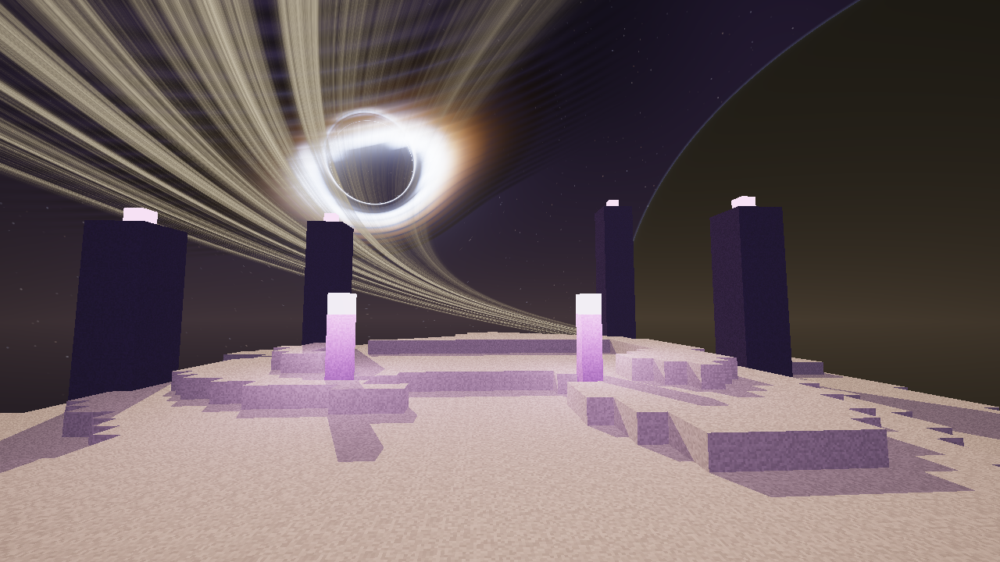
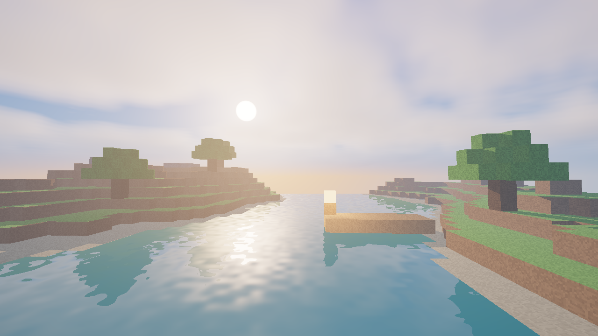
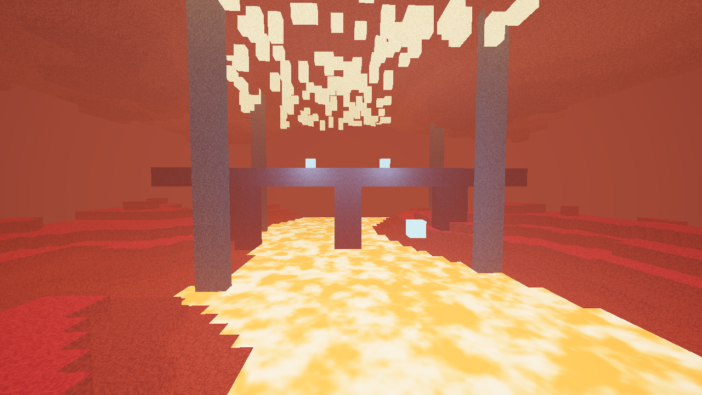

# Photon Horizon (`photon_horizon`) — v1.0.0

Un pack de shaders natif **WGSL** pour **Horizon Launcher** (`api = "0.1"`), combinant **Photon Shaders** (par *SixthSurge*) pour l'Overworld et le Nether avec le ciel cosmique de l'**End d'IterationT** (par *Tahnass*).

---

## 📸 Aperçus (Screenshots)

### 🌌 The End — IterationT (Planète géante à anneaux & Trou noir à lentille gravitationnelle)


### 🌅 Overworld — Photon (Atmosphère Rayleigh/Mie, Nuages volumétriques Cumulus/Cirrus & Eau Beer-Lambert)


### 🔥 Nether — Photon (Lumières colorées par bloc, Mer de lave corps noir, Glowstone & Soul Fire)


---

## ✨ Fonctionnalités

1. **Photon Shaders** (par *SixthSurge*) pour l'**Overworld** et le **Nether** :
   - Diffusion atmosphérique physique Rayleigh, Mie & Ozone, lever/coucher de soleil réaliste et halo lunaire.
   - Nuages volumétriques **Cumulus 3D** + **Cirrus** haute altitude avec auto-ombrage multi-scattering et ombres de nuages projetées au sol.
   - **Aurores boréales** dynamiques et **Voie Lactée** nocturne.
   - BSDF **Hammon diffuse** + **Smith-GGX specular** + Subsurface Scattering (SSS) sur le feuillage + support complet **LabPBR** + flaques de pluie (`rain_puddles`).
   - Eau **Photon** avec absorption physique **Beer-Lambert**, réfraction, réflexions planaires, vagues multi-octaves et caustiques sous-marines.
   - **GTAO** (Ground Truth Ambient Occlusion), **God Rays** (rayons crépusculaires), **ombres douces** colorées (vitraux), **lumières colorées** par bloc et tenues en main.
   - 4 opérateurs de **Tonemapping** issus de Photon (*Academy Fit ACES*, *Hejl-Burgess*, *Lottes*, *Ozius*), **effet Purkinje** nocturne, Bloom Karis dual-scale, FXAA + **CAS** (Contrast Adaptive Sharpening).

2. **IterationT End Sky** (par *Tahnass*) pour **l'End (`dimension == 1`)** :
   - **Planète géante à anneaux** (`PlanetEnd2`) avec atmosphère diffusante (fonction H de Chandrasekhar `it_ppss`), bandes nuageuses et ombres portées des anneaux.
   - **Trou noir à lentille gravitationnelle** (`BlackHole_AccretionDisc_Stars`) avec disque d'accrétion relativiste, décalage Doppler et corps noir (`blackbody`).
   - Champ d'étoiles procédural, brouillard volumétrique de l'End (`EndFog`) et réflexions de la planète et du trou noir sur l'eau et les surfaces spéculaires de l'End.

---

## 📥 Installation dans Horizon Launcher

1. Copiez `photon_horizon-1.0.0.hshader` dans :
   `%APPDATA%\horizon\shaderpacks\`
2. Dans Horizon, ouvrez **Options → Graphismes → Packs de shaders** et sélectionnez **Photon Horizon ( + IterationT End )**.

## 🛠️ Compiler / Vérifier depuis les sources

Avec l'outil officiel `horizon-shader` :
```powershell
horizon-shader check .
horizon-shader pack .
```
